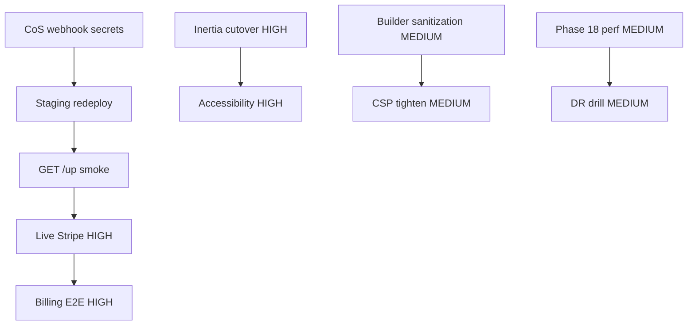

# MarketPulse — Work plan (October 2026)

Ordered backlog reconciled with `staging` @ `8d74b62+`, [`TODO.md`](../TODO.md), and [`docs/security-audit-2026-10.md`](security-audit-2026-10.md). **MarketPulse** naming unchanged.

---

## CRITICAL

1. **CoS staging secrets & redeploy** — Ensure staging runs current tip; set `STRIPE_WEBHOOK_SECRET`, PayPal webhook keys, and social secrets (`LINKEDIN_WEBHOOK_SECRET`, Meta, Twitter, TikTok, Pinterest) per `.env.example`. Smoke: `GET https://marketing-manager.staging.oneinternetmedia.com/up` only post-deploy.
2. **Payment webhook integrity in production** — Verify [#76](https://github.com/one-dev-studio/marketingmanager-laravel/pull/76) behavior with real Stripe signing secret; exercise admin **Payment webhook settings** UI ([#85](https://github.com/one-dev-studio/marketingmanager-laravel/pull/85)) after deploy.

*No open application Critical code defects at audit tip; blocked on environment configuration.*

---

## HIGH

### Phase 11 — Billing & subscriptions
3. **Live Stripe checkout** — Configure `STRIPE_*` on staging/production; end-to-end subscribe / upgrade / cancel / webhook invoice updates (extends existing `PaymentGatewayService`).
4. **PayPal production path** — Replace stub with verified webhook flow when keys available.
5. **Billing UX hardening** — Payment method errors, dunning, and invoice PDF delivery on real gateways (Inertia billing pages exist).

### Phase 15 — Frontend (finish migration & polish)
6. ~~**Complete Inertia cutover**~~ — **Done (2026-10-15):** removed legacy `layouts.app` shells, Blade sidebar partials, Vue builder islands, and `resources/js/app.js`; Vite inputs documented in README.
7. ~~**Agency sidebar parity**~~ — **Done (2026-10-15):** shared `ShellMobileSidebar` drawer; agency + customer headers wire mobile menu toggle.
8. ~~**Accessibility pass**~~ — **Done (2026-10-15):** skip link, menu `aria-expanded`/`role="menu"`, Escape on disclosures, focus rings on shell controls.
9. ~~**Real-time collaboration**~~ — **Done (2026-10-15):** `.env.example` documents `PUSHER_*` / `VITE_PUSHER_*` / `BROADCAST_*`; server falls back to `log` when pusher credentials are incomplete; Inertia shares `realtime` client config.

### Quality gate
10. **PHP 8.4+ test suite on deploy host** — Full `php vendor/bin/phpunit` (Symfony 8.1 constraint); fix stale `PaymentProcessingTest` assertions if still failing.

---

## MEDIUM

### Security follow-ups
11. ~~**Builder preview sanitization**~~ — **Done (2026-10-15):** DOMPurify + sandboxed iframe preview for email/landing builders; `UserHtmlSanitizer` tests for parity on save.
12. **CSP tightening** — Remove `style-src 'unsafe-inline'` when Tailwind build supports nonces/hashes globally.

### Phase 18 — Performance
13. Database index review on hot paths (`scheduled_posts`, notifications, tasks).
14. Vite code-splitting / lazy routes for large admin lists.
15. Query timing + slow endpoint list (Telescope/Sentry APM optional).

### Phase 19 — DevOps & docs
16. Disaster recovery + **backup restore drill** (script exists; procedure not exercised).
17. End-user guides (optional); OpenAPI via Scribe remains optional vs `route:list` inventory.
18. CDN + upload virus scanning when vendor chosen.

### Backend niceties
19. Onboarding **website fetch** tool (`getWebsiteContent`) if still product-required beyond AI prompt.
20. PDF annotation detection service (content approval) if not fully covered by current review UI.
21. Storage quota enforcement UI sync with backend limits.

---

## Dependency graph (simplified)

---

## Explicitly not planned (unless product changes)

- Renaming MarketPulse
- Adding Laravel Cashier (Laravel 13 path uses custom gateway)
- Mandatory GitHub Actions CI for every PR (org rule: prove in Cursor Environment; deploy workflows only)

---

*Author: doc reconciliation pass, 2026-10-15*
